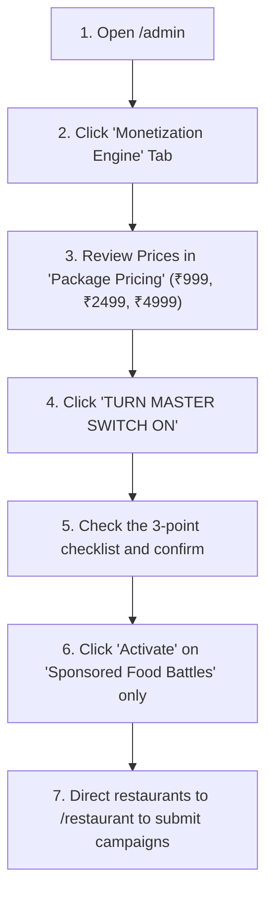

# 🍽️ PALATE — India's Food Fights Begin Here ⚔️🇮🇳

> **"Your favourite dish is someone's biggest debate. Vote, settle the score, and defend your taste."**

PALATE is a mobile-first, social food discovery platform launching in **Navi Mumbai, Maharashtra, India** (starting across **Vashi, Nerul, Belapur, Kharghar, and Seawoods**).

Unlike traditional review directories (where restaurants get vague 4-star ratings based on air-conditioning or parking), **PALATE turns food discovery into a competitive social game**. We pit the city's most beloved street dishes and legendary restaurants head-to-head, let passionate foodies vote for their favorites, share results across WhatsApp and Instagram, and challenge the winners to keep the rivalry alive.

---

## 🧭 Quick Links & Application Directory

### 🌐 Live Application Interfaces (When Running Locally)
- **Home Arena & Live Battles:** [http://localhost:3000](http://localhost:3000)
- **Sample Battle Detail Arena:** [http://localhost:3000/battle/vashi-vs-nerul-best-vada-pav](http://localhost:3000/battle/vashi-vs-nerul-best-vada-pav)
- **Admin Moderation & Monetization Console:** [http://localhost:3000/admin](http://localhost:3000/admin)
- **Restaurant Partner Portal:** [http://localhost:3000/restaurant](http://localhost:3000/restaurant)

### 🔌 API Endpoints
- **Battles & Matchups:** [`/api/battles`](http://localhost:3000/api/battles)
- **Anti-Fraud 1-Tap Voting:** [`/api/vote`](http://localhost:3000/api/vote)
- **Challenge the Winner Engine:** [`/api/challenges`](http://localhost:3000/api/challenges)
- **Growth Funnel Telemetry:** [`/api/analytics`](http://localhost:3000/api/analytics)
- **Monetization Settings & Flags:** [`/api/monetization/settings`](http://localhost:3000/api/monetization/settings)
- **Campaigns Lifecycle:** [`/api/monetization/campaigns`](http://localhost:3000/api/monetization/campaigns)
- **Customer Acquisition Offers:** [`/api/monetization/offers`](http://localhost:3000/api/monetization/offers)
- **Administrative Audit Trail:** [`/api/monetization/audit`](http://localhost:3000/api/monetization/audit)

### 📁 Key Codebase Files
- **Homepage:** [`src/app/page.tsx`](file:///Users/nikhilzagade/.gemini/antigravity-ide/scratch/palate-web/src/app/page.tsx)
- **Battle Page (SSR + Client Arena):** [`src/app/battle/[slug]/page.tsx`](file:///Users/nikhilzagade/.gemini/antigravity-ide/scratch/palate-web/src/app/battle/[slug]/page.tsx) & [`BattleDetailClient.tsx`](file:///Users/nikhilzagade/.gemini/antigravity-ide/scratch/palate-web/src/app/battle/[slug]/BattleDetailClient.tsx)
- **WhatsApp/Instagram Share Card Modal:** [`src/components/ShareableBattleCardModal.tsx`](file:///Users/nikhilzagade/.gemini/antigravity-ide/scratch/palate-web/src/components/ShareableBattleCardModal.tsx)
- **Admin Console:** [`src/app/admin/page.tsx`](file:///Users/nikhilzagade/.gemini/antigravity-ide/scratch/palate-web/src/app/admin/page.tsx) & [`AdminMonetizationSection.tsx`](file:///Users/nikhilzagade/.gemini/antigravity-ide/scratch/palate-web/src/components/AdminMonetizationSection.tsx)
- **Restaurant Partner Portal:** [`src/app/restaurant/page.tsx`](file:///Users/nikhilzagade/.gemini/antigravity-ide/scratch/palate-web/src/app/restaurant/page.tsx)
- **Core Battle Store:** [`src/lib/store.ts`](file:///Users/nikhilzagade/.gemini/antigravity-ide/scratch/palate-web/src/lib/store.ts)
- **Monetization Engine:** [`src/lib/monetizationStore.ts`](file:///Users/nikhilzagade/.gemini/antigravity-ide/scratch/palate-web/src/lib/monetizationStore.ts)
- **Payment Gateway Abstraction:** [`src/lib/paymentProvider.ts`](file:///Users/nikhilzagade/.gemini/antigravity-ide/scratch/palate-web/src/lib/paymentProvider.ts)
- **PostgreSQL / Supabase Schema:** [`schema.sql`](file:///Users/nikhilzagade/.gemini/antigravity-ide/scratch/palate-web/schema.sql)
- **Automated Test Suite:** [`scripts/test_monetization_suite.sh`](file:///Users/nikhilzagade/.gemini/antigravity-ide/scratch/palate-web/scripts/test_monetization_suite.sh)

---

## 💡 The Core Startup Idea in Plain English

Every foodie in Mumbai and Navi Mumbai has fierce opinions:
- *"Sector 17 Vashi has the best Vada Pav."*
- *"No way, Nerul Station East wipes the floor with it!"*

PALATE turns these passionate local debates into **interactive, bite-sized food fights**:

```
DISCOVER A BATTLE ──▶ VOTE (1-Tap) ──▶ SEE RESULTS ──▶ SHARE (WhatsApp) ──▶ CHALLENGE THE WINNER ──▶ START NEXT BATTLE
```

### Why this is different from Zomato, Swiggy, or Google Reviews:
1. **Zero Essay Writing:** Nobody wants to write a 300-word essay about chutney. You tap **Team Blue** or **Team Pink**, watch the percentage bars react in real time, and trigger celebratory confetti.
2. **Built for WhatsApp & Instagram:** Every battle generates beautiful, brutalist street-poster share cards (*"Vashi says A. Nerul says B. Who makes the better Vada Pav? Settle the score."*).
3. **The Viral "Challenge the Winner" Loop:** When a champion emerges, defeated fans don't just walk away—they propose a rival stall to dethrone the champion, automatically generating the next battle!
4. **Transparent Community Taste:** We never claim a restaurant is "objectively the Michelin-star best." We clearly label votes as an authentic reflection of community popularity and local pride.

---

## ⚔️ The 3 Types of Food Battles

| Battle Type | Real-World Example | How It Works |
| :--- | :--- | :--- |
| **Type A: Dish Battle** | *Vashi Sector 17 vs Nerul East: The Street Vada Pav War* | Compares two specific vendors serving the same iconic dish in different neighborhoods. |
| **Type B: Restaurant Battle** | *Yasin's Food Inn vs Persian Darbar: Best Dum Biryani* | Compares two full-service restaurants serving a comparable culinary specialty. |
| **Type C: Food Debate** | *Vada Pav vs Pav Bhaji: The Ultimate Mumbai Showdown* | An ideological debate about Indian street culture, independent of specific vendors. |

---

## 🎨 Brand & Visual System

PALATE uses an **Indian street-poster, neo-brutalist aesthetic** designed to stand out on mobile screens:

- **Yellow (`#FFD11A`):** Used for primary action buttons (CTAs) and victory celebrations.
- **Blue (`#2748FF`):** Contestant A (Team Blue).
- **Pink (`#FF5C9A`):** Contestant B (Team Pink).
- **Mint (`#00B26B`):** Unlocked badges, streaks, and verified actions.
- **Paper (`#F6EFE2`):** Primary warm background (feels like physical Indian newspaper/kraft paper).
- **Tar (`#121212`):** Crisp high-contrast headlines, typography, and thick `2.5px` borders with `4px` drop shadows.

> **Design Rule:** No dark mode void, no generic SaaS dashboard glassmorphism, and no neon gradients. PALATE feels tactile, physical, energetic, and rooted in Indian street culture.

---

## 💰 Monetization Strategy: "Build Now, Activate Later"

### The Golden Principle
> **PALATE users discover and vote 100% free. Restaurants pay for transparent promotional visibility and real customer footfall. Winning cannot be bought.**

### Why It's Turned OFF by Default
Monetization is completely implemented under the hood, but **every paid feature is locked by default** (`monetization_enabled = false`). You should never charge restaurants on Day 1. First, get thousands of local foodies debating and sharing. Once organic traffic is established, the administrator can activate features with a single click from the **Admin Console (`/admin`)**.

### The 4 Revenue Streams
1. **Sponsored Food Battles (Starter ₹999, Local Spotlight ₹2,499, Featured ₹4,999):** Restaurants pay for promotional placement around a battle. They get a `"SPONSORED PROMOTION"` badge and top-of-feed visibility. **They cannot buy votes.**
2. **Champion Packages (Spotlight ₹1,499, Legend ₹2,999):** When a restaurant organically wins a battle, they unlock optional victory packages (counter QR standees, social media winner cards, Leaderboard Crest). **Only verified winners can buy this!**
3. **Customer Acquisition Offers (Diner Discounts):** Restaurants publish deals (e.g. *"₹30 Off on orders above ₹150"*). Foodies get a single-use coupon. The restaurant pays a small agreed fee (e.g. ₹30) only for **verified in-store redemptions**.
4. **Brand Sponsorships:** City-wide banner sponsorships for food brands and FMCG partners.

---

## 🚦 Step-by-Step Guide: What to Do & What NOT to Do

### 1. For Founders & Growth Operators

#### ✅ WHAT TO DO:
- **Seed intense, authentic local rivalries:** Don't start with generic battles. Pick two tapris that college students or office workers in Vashi, Nerul, or Kharghar fiercely argue about.
- **Distribute through WhatsApp Groups:** Share the Format A Battle Card (*"Vashi says A. Nerul says B."*) into college groups, residential society chats, and food influencer groups. WhatsApp is the primary engine of Indian viral distribution.
- **Rally the Defeated:** When a battle concludes, send a notification or link: *"Contestant B lost! Think someone else can beat Contestant A? Challenge the winner now!"*
- **Engage Restaurant Owners in Person:** Walk up to the winning tapri or cafe, show them their live vote counts on PALATE, and explain that hundreds of locals voted for their dish. This builds real grassroots trust.
- **Watch the One Key Metric:** Measure: *How many people arrive through a shared battle link and then share a battle themselves?* If this number is growing, you have product-market fit.

#### ❌ WHAT NOT TO DO:
- **DO NOT turn on monetization before you have regular users:** Charging restaurants when you have 50 visitors will kill trust. Keep monetization disabled until you have real organic momentum.
- **DO NOT fabricate fake votes or fake live user counters:** Indian consumers and restaurant owners quickly spot fake bots. Real credibility is your only long-term defense.
- **DO NOT claim a restaurant is "objectively the best in the world":** Always frame results as community popularity and taste debates, not certified food hygiene or quality inspections.
- **DO NOT force users to sign up before voting:** Forcing a 4-field sign-up form on a casual voter kills 80% of traffic. Use the built-in anonymous device fingerprinting so people can vote in 1 tap.
- **DO NOT spam people:** Keep battles focused on authentic food and authentic rivalries.

---

### 2. For Software Engineers & Product Developers

#### ✅ WHAT TO DO:
- **Enforce feature flags on the server:** Keep all monetization endpoints locked via `monetizationStore.isFeatureEnabled()`. Hiding a button on the screen is not security.
- **Preserve financial and audit logs:** When an admin turns off a feature flag, prevent new purchases, but **never delete existing transactions or active campaigns**.
- **Store monetary values in integer paise:** Always handle money as integer paise (`₹999 = 99900` paise) to prevent floating-point calculation bugs.
- **Run the automated test suite:** Run `./scripts/test_monetization_suite.sh` before any major release to ensure that anti-fraud voting, duplicate prevention, and feature flag rules work.
- **Maintain sub-second mobile page loads:** Most visitors will click shared links from low-bandwidth mobile 4G/5G connections on WhatsApp. Keep assets optimized and ensure server-rendered Open Graph tags preview crisply.

#### ❌ WHAT NOT TO DO:
- **DO NOT expose secret keys on the frontend:** Never put `RAZORPAY_KEY_SECRET`, `CASHFREE_SECRET_KEY`, or database service-role keys in public frontend files.
- **DO NOT allow clients to set arbitrary vote numbers:** Vote increments must always happen atomically on the server via [`/api/vote`](file:///Users/nikhilzagade/.gemini/antigravity-ide/scratch/palate-web/src/app/api/vote/route.ts).
- **DO NOT let restaurants alter organic voting scores:** Even if a restaurant pays for the top Featured Campaign, their vote counts and percentages must remain 100% organic.
- **DO NOT break mobile viewport constraints:** Palate is mobile-first. Ensure horizontal overflow (`overflow-x`) is strictly prevented and interactive elements are easily tappable with thumbs.

---

### 3. For Restaurant Partners

#### ✅ WHAT TO DO:
- **Rally your regulars:** Put your battle link on your Instagram story or print a small counter standee: *"Vote for us on PALATE in the Navi Mumbai Food Fights!"*
- **Challenge the Champion:** If your rival won last week's battle, use the **Partner Portal (`/restaurant`)** to submit a formal challenge and settle the score.
- **Offer trackable diner discounts:** Use Customer Acquisition Offers (e.g. ₹30 Off) to convert voters into physical paying diners at your tables.
- **Celebrate real achievements:** When you win, claim your Champion Crest to display on your counter and leaderboard profile.

#### ❌ WHAT NOT TO DO:
- **DO NOT try to pay to win:** Palate does not sell votes, artificial review ratings, or fake trophies.
- **DO NOT attempt to claim Champion packages without winning:** The platform automatically verifies battle results and rejects unauthorized claims.
- **DO NOT honor expired or duplicate coupons:** The platform automatically limits offers to 1 per customer device to protect your margins.

---

## 🛠️ Step-by-Step Developer Quickstart

### 1. Requirements
- Node.js 18+ or 20+
- npm or yarn

### 2. Installation
```bash
# Navigate to the project directory
cd /Users/nikhilzagade/.gemini/antigravity-ide/scratch/palate-web

# Install dependencies
npm install
```

### 3. Running Locally
```bash
# Start the Turbopack development server
npm run dev
```
Open [http://localhost:3000](http://localhost:3000) in your browser (switch to Mobile View in Chrome DevTools: `390 x 844`).

### 4. Running the Monetization Test Suite
We have built an end-to-end automated test script that tests all 16 mission-critical business and security rules:
```bash
./scripts/test_monetization_suite.sh
```

### 5. Building for Production
```bash
npm run build
```

---

## 🔐 How an Administrator Activates Monetization for a Pilot

When you are ready to test paid campaigns with your first 3 to 5 pilot restaurants in Navi Mumbai:



1. Open [http://localhost:3000/admin](http://localhost:3000/admin).
2. Click the **"💰 Monetization Engine (Build Now, Activate Later)"** tab.
3. Review your pricing under the **"Package Pricing"** sub-tab. (You can click *"Edit Price"* to change prices instantly without touching code).
4. Click **"TURN MASTER SWITCH ON"**.
5. Complete the 3-point verification checklist and click **"Confirm & Activate"**.
6. Turn on **"Sponsored Food Battles"**. (Leave Champion Packages and Offers disabled until you are ready for those stages).
7. Invite your pilot restaurants to [http://localhost:3000/restaurant](http://localhost:3000/restaurant). The "Coming Soon" lock will disappear, and they can submit their first sponsored battle campaign!

---

## 🚀 The Vision

PALATE was built to prove that **food discovery in India doesn't have to be boring, paid-off, or fake**. By letting local street culture and authentic rivalries take center stage, we give diners a reason to participate every single week—and give great local food stalls the recognition they truly deserve.

*India's Food Fights Begin Here.* 🇮🇳🔥
